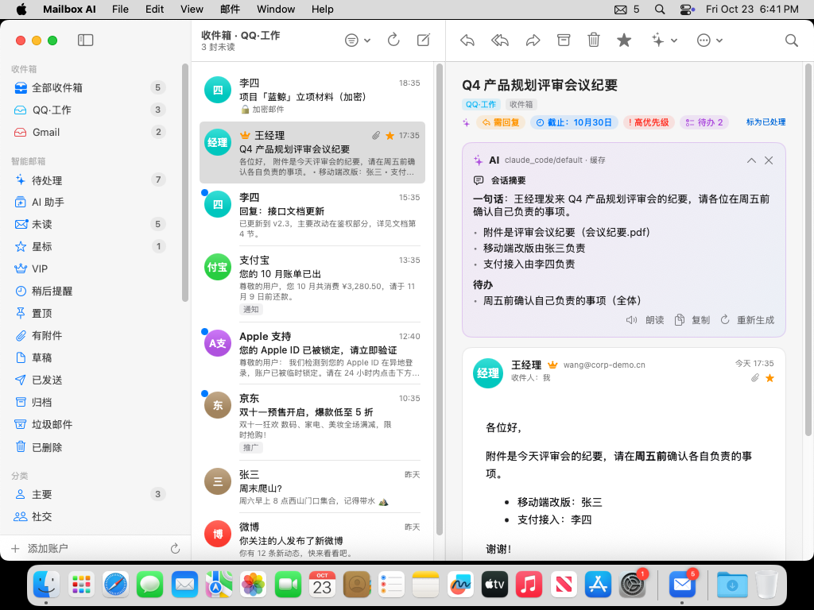
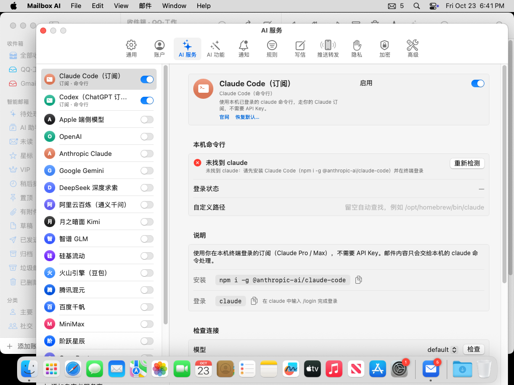
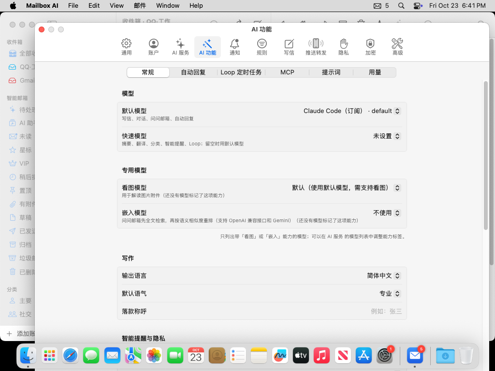
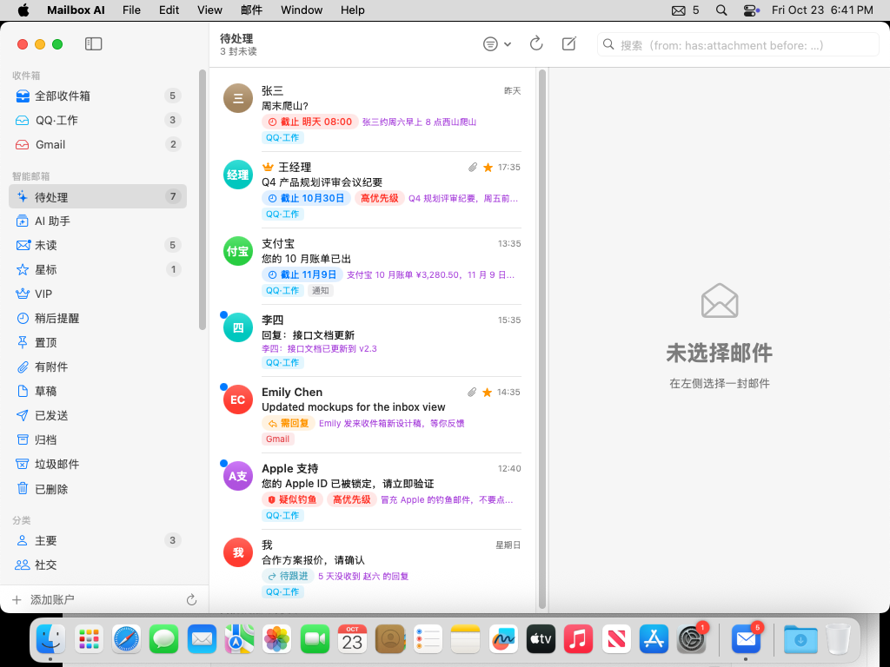
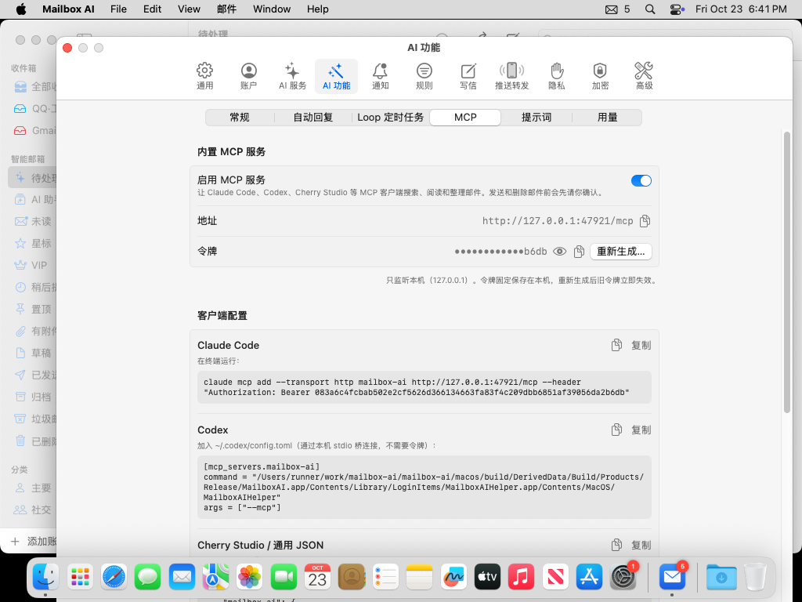
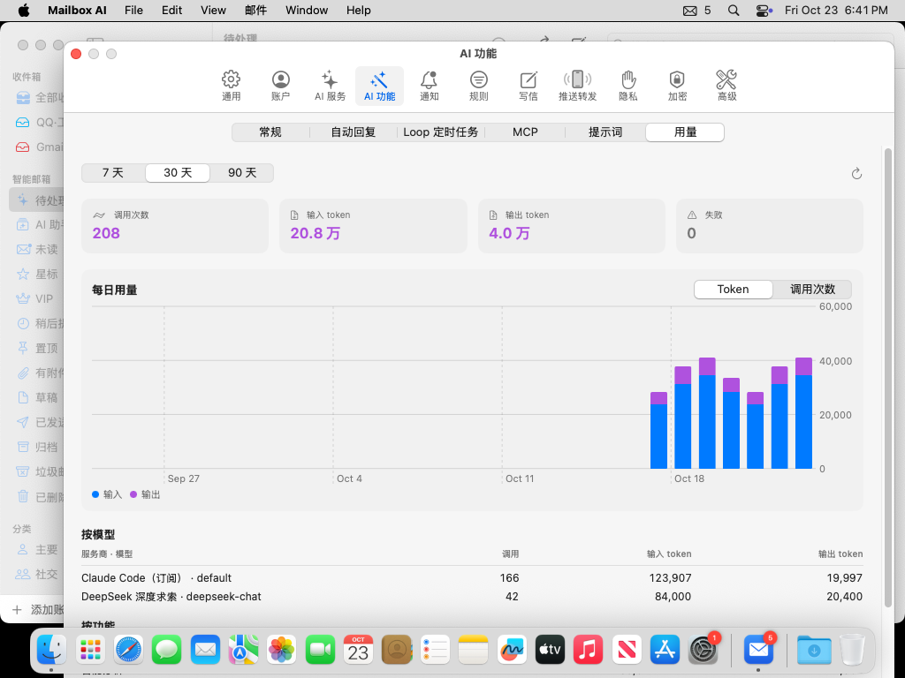
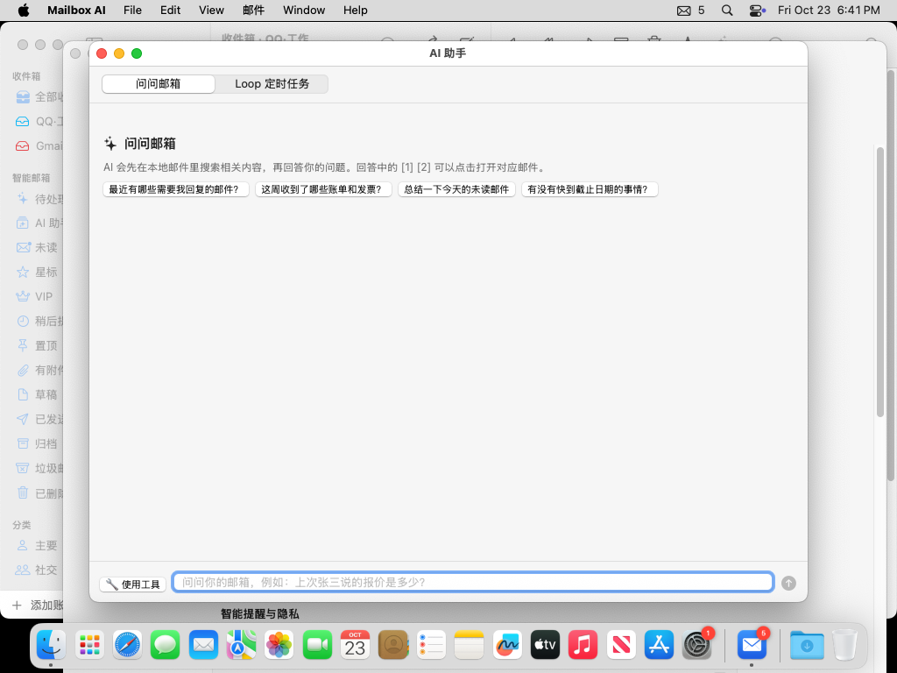

<p align="center"></p>

<h1 align="center">Mailbox AI</h1>

<p align="center">带 AI 的轻量 macOS 聚合邮箱：Gmail、Outlook / Hotmail、QQ、Foxmail、163、126、iCloud、ProtonMail… 一个收件箱全部搞定，再加上润色、代读、自动回复、批量处理、Loop 和智能提醒。</p>

> 这是 **AI 版**。不需要 AI 的话，请用更轻的无 AI 版 [ComeHereToSee/mailbox](https://github.com/ComeHereToSee/mailbox)。两个版本可以同时安装，数据互不影响。



| AI 服务（Cherry Studio 风格） | AI 功能 | ✨ 待处理（截止、钓鱼、跟进） |
|---|---|---|
|  |  |  |

| 内置 MCP 服务 | 用量统计 | AI 助手 |
|---|---|---|
|  |  |  |

<sub>截图由 CI 在 macOS 15 上用演示数据（`--demo`）自动拍摄。</sub>

## AI 功能

- **AI 服务接入（参考 Cherry Studio）**：
  - 内置 22 个服务商：OpenAI、Anthropic、Gemini、DeepSeek、通义千问（阿里云百炼）、Kimi、智谱 GLM、硅基流动、豆包、腾讯混元、百度千帆、MiniMax、阶跃星辰、OpenRouter、Groq、Mistral、xAI、Azure OpenAI，以及本地的 Ollama、LM Studio 和 Apple 端侧模型（macOS 26 的 Apple Intelligence，免费、不联网）。
  - 每个服务商可以填 API Key（可以填多个，轮流使用）和 API 地址，可以拉取或手动添加模型，可以检查连接；也可以添加任意 OpenAI 兼容的自定义服务商。
  - 模型带能力标签（看图、推理、工具、嵌入），还可以单独指定看图模型和向量嵌入模型。
  - 写作和对话用「默认模型」，摘要、分类、提醒等后台任务用便宜的「快速模型」。
- **直接用 Claude Code / Codex 订阅**：
  - 在终端登录过 `claude` 或 `codex` 后，选择「Claude Code」或「Codex」服务商即可。不需要 API Key，费用算在你自己的订阅里。
  - 调用时 AI 只能读到这次要处理的邮件内容，不能读写文件，也不能执行命令。
- **写信**：
  - ✨ 润色、更正式、更友好、更简洁、扩写、纠错、翻译。选中文字时只改写选中部分。
  - 「帮我写」：说一句要求，生成整封邮件；也可以根据正文生成主题。
  - 回复时的「一键回复」：比如输入「同意，下周二可以」，生成完整回复。
- **代读**：
  - 一键总结邮件或整个会话：一句话结论、要点和待办。打开长邮件时可以自动总结。
  - 用系统语音朗读摘要或全文，也可以把邮件翻译成中文或英文。
- **日程提取**：把邮件里提到的会议和活动换算成具体时间，确认后加入日历。
- **解读附件**：总结 PDF、图片（需要支持看图的模型）和文本附件。
- **建议回复**：针对当前邮件给出 3 条回复建议，点一下就打开写好的回复。
- **自动回复**：
  - 按条件匹配邮件：发件人、主题，或用一句话描述，例如「客户询问报价」，由 AI 判断。
  - 匹配后生成回复草稿并通知你，也可以设为直接发送。
  - 会自动跳过 noreply、群发和其他自动回复，并限制每天的次数，避免回复循环。
  - 另有休假回复：在设定的日期内自动回复固定内容，不调用 AI。
- **批量处理**：多选邮件后，可以一次性总结、分类打标签、提取待办、生成回复草稿、退订，或执行自定义指令。分类建议先给你确认再执行。
- **Loop（定时 AI 任务）**：按时自动处理一批邮件，比如每天早上 8 点总结未读、工作日傍晚检查待回复、每周汇总账单。结果会发通知，也可以投递到收件箱。
- **智能提醒**：新邮件到达时，AI 判断是否需要回复、有没有截止日期和待办。
  - 结果汇总在侧边栏的「✨ 待处理」。
  - 快到截止时间时，会弹出带账户名的提醒。
  - 通知可以附上一句 AI 摘要，也可以设为只提醒重要邮件。
  - 识别钓鱼和诈骗邮件。
  - 自己发出的邮件过了几天还没收到回复时，提醒你跟进。
- **问问邮箱**：用自然语言提问，比如「上个月京东的账单多少钱？」。回答里会标出引用的邮件，点击就能打开。打开「使用工具」后，还能调用外部 MCP 工具。
- **MCP**：
  - 内置邮箱 MCP 服务，Claude Code、Codex、Cherry Studio 可以直接搜索、阅读、整理邮件和写草稿。发送和删除每次都要你在应用里确认。
  - AI 助手也可以接入外部 MCP 工具。
- **提示词库与用量统计**：保存常用指令，用在写信、阅读和批量处理中；按天、按模型、按功能统计 token 用量。
- **隐私**：
  - API Key 加密保存在本机，不写入数据库。
  - 每次只发送需要处理的邮件，正文有长度上限。
  - 加密邮件默认不交给 AI。
  - 每个账户可以单独关闭 AI，或者只允许本地模型处理。
  - 想完全不出本机，可以用 Apple 端侧模型、Ollama 或 LM Studio。

详细用法见 [AI 使用说明](docs/guides/ai.md)；接口见 [docs/AI.md](docs/AI.md)。

## 邮件功能（与无 AI 版相同）

- **原生又轻**：SwiftUI 界面 + Rust 核心。后台 Helper 常驻菜单栏负责收信，主窗口关掉也照常提醒。
- **所有常见邮箱**：内置 33 个服务商预设；其他邮箱可按 MX / ISPDB / SRV 自动识别。支持 IMAP（含 IDLE 实时推送）、POP3 和 SMTP。
- **登录省心**：
  - Gmail / Outlook 在你的默认浏览器里登录，就像在 Chrome 里登录一样。
  - QQ / 163 / 126 有内置浏览器，一步步引导你开启 IMAP、生成授权码。
  - 还有“网页模式”，任何网页邮箱都能嵌进来当一个账户用。
- **提醒注明账户**：通知标题形如 `[QQ·工作] 张三`。可以直接在通知里回复、标为已读、归档或删除。
- **完整收发**：
  - 富文本编辑（字体、颜色、列表、表格、图片、链接），也有 Markdown 和纯文本模式。
  - 收件人、抄送、密送，联系人自动补全。
  - 回复、全部回复、转发、作为附件转发。
  - 撤销发送、定时发送、模板、多身份签名、已读回执。
- **高效处理**：
  - 统一收件箱、会话视图、收件箱分类（主要 / 社交 / 推广 / 通知 / 论坛）。
  - 星标、置顶、稍后提醒、标签、规则、VIP。
  - 一键退订、屏蔽发件人、撤销操作，以及 Gmail 风格快捷键。
- **搜索**：本地全文搜索，中文按双字切分；支持 `from:` `has:attachment` `before:` 等语法；可保存为智能文件夹，也可以做服务器端搜索。
- **系统集成**：
  - 会议邀请可以接受、暂定或拒绝，并加入日历；邮件可以生成提醒事项。
  - 分享扩展、服务菜单，可设为默认邮件应用。
  - Spotlight 搜索、快捷指令、Touch ID 锁。
- **推送到手机 / 聊天工具**：Bark（iPhone）、Server酱 / PushPlus（微信）、企业微信、飞书、钉钉、Telegram、ntfy，或自定义 Webhook。
- **隐私**：
  - 默认拦截远程图片和跟踪像素，链接与显示地址不一致时会提示。
  - 凭据和本地邮件文件加密保存，主密钥放在钥匙串里。
  - **PGP / S/MIME**：自动解密、验证签名；写信时一键签名 / 加密（收件人都有公钥时自动加密）。可以生成 PGP 密钥，导入 .asc / .p12 / 证书；已用 GnuPG 和 OpenSSL 双向验证互通。
  - 不经过任何第三方服务器。

## 安装

1. 在仓库的 Actions 页面（或 Releases）下载 `MailboxAI.dmg`，把 MailboxAI 拖进“应用程序”。
2. 应用没有开发者签名，第一次打开需要二选一：
   - 在 Finder 里**右键 MailboxAI → 打开**；
   - 或者在终端执行 `xattr -dr com.apple.quarantine /Applications/MailboxAI.app`。
3. 首次启动后会出现 **Mailbox AI Helper** 的通知授权弹窗，请选择“允许”。
4. 想登录时自动在后台收信：设置 → 通用 → “登录时在后台启动”。

各邮箱的登录方法见 [docs/guides](docs/guides/)：

| 邮箱 | 说明 |
|---|---|
| QQ / Foxmail / 腾讯企业邮 | [授权码](docs/guides/qq.md) |
| 163 / 126 / yeah / 188 | [授权码](docs/guides/netease.md) |
| Gmail | [OAuth 客户端或应用专用密码](docs/guides/gmail.md) |
| Outlook / Hotmail / Office 365 | [OAuth 客户端](docs/guides/outlook.md) |
| iCloud | [App 专用密码](docs/guides/icloud.md) |
| ProtonMail | [Proton Mail Bridge](docs/guides/proton.md) |
| 推送到手机 | [Bark / Server酱 / 企业微信 …](docs/guides/push.md) |

## 自己构建

需要 macOS 14+、Xcode 16+、Rust（rustup）和 XcodeGen：

```bash
brew install xcodegen
scripts/build-macos.sh          # 生成 dist/MailboxAI.dmg
# 只构建本机架构，速度更快：
ARCHS=arm64 scripts/build-macos.sh
```

## 架构

```
MailboxAI.app（SwiftUI）  ──HTTP/WebSocket（127.0.0.1 + token）──┐
Contents/Library/LoginItems/MailboxAIHelper.app                    │
   ├─ 菜单栏迷你收件箱、系统通知                                  │
   └─ libmailcore.a（Rust）◀──────────────────────────────────────┘
        ├─ IMAP / POP3 / SMTP / OAuth2 / 自动发现
        ├─ 同步引擎（IDLE、增量、离线操作队列、撤销）
        ├─ SQLite + FTS5（中文双字切分）
        └─ 规则、分类、日历邀请、推送转发
```

- `core/`：Rust 工作区
  - `mailcore`：引擎库
  - `mailcore-ffi`：给 Helper 用的 C 接口
  - `mailboxd`：无界面守护进程，开发和测试用
- `macos/`：Xcode 工程（XcodeGen），包含 Mailbox、MailboxHelper、ShareExtension 三个目标
- 本地 API 见 [docs/API.md](docs/API.md)，需求基线见 [docs/REQUIREMENTS.md](docs/REQUIREMENTS.md)

## 测试

协议层用真实的邮件服务器做集成测试：

```bash
scripts/test-env/start.sh       # 启动 Dovecot（IMAP/POP3）+ GreenMail（SMTP）
cd core && MAILBOX_TEST_SERVERS=1 cargo test
```

CI 在 Linux 上跑核心测试，在 macOS 上构建 App 和 DMG。
